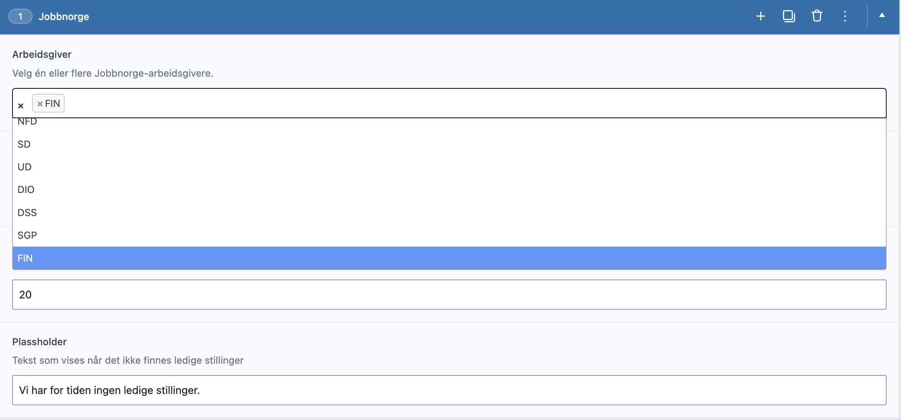

# Jobbnorge Module for [Hogan](https://github.com/dekodeinteraktiv/hogan-core)

List job postings from [Jobbnorge](https://www.jobbnorge.no/search/en)

The module uses the public Jobbnorge API. Add the employer ID supplied by
Jobbnorge in the module settings. Multiple employer IDs can be separated by
commas.

When the `jobbnorge_employers` filter supplies employers, Hogan displays them
as a multi-select field. This is the same server-provided employer list used by
the Jobbnorge block.

The existing FIN JobListBuilder URL is automatically mapped to employer ID
`1994`. Other legacy feed URLs should be replaced with their corresponding
employer IDs or mapped with the
`dss/hogan/module/jobbnorge/legacy_employer_map` filter.

## The module



## Installation
Downloading this repository and place it in `wp-content/plugins`

## Available filters
- `dss/hogan/module/jobbnorge/items` : Set default number of items.
- `dss/hogan/module/jobbnorge/words` : Set default number of words per item.
- `dss/hogan/module/jobbnorge/api_url`: Change the public API endpoint.
- `jobbnorge_cache_time`: Change the API cache duration. Hogan uses the same filter as the Jobbnorge block; the default is 30 minutes.
- `dss/hogan/module/jobbnorge/cache_duration`: Override the cache duration for Hogan after `jobbnorge_cache_time` has run.
- `dss/hogan/module/jobbnorge/api_error`: Runs when an API request or response fails.
- `jobbnorge_cache_path`: Set the file cache directory. Hogan uses the same filter as the Jobbnorge block.
- `dss/hogan/module/jobbnorge/cache_error`: Runs when the configured file cache cannot be read or written.
- `dss/hogan/module/jobbnorge/legacy_employer_map`: Map legacy JobListBuilder UUIDs to employer IDs.
- `dss/hogan/module/jobbnorge/html/wrapper/start`: The HTML start wrapper, the default is:
	```php
	<ul class="list-items card-type-large">
	```
- `dss/hogan/module/jobbnorge/html/wrapper/end`: The HTML end wrapper, the default is:
	```php
	</ul>
	```
- `dss/hogan/module/jobbnorge/html/item` The HTML for each item, the default is:
	```html
	<ul class="list-items card-type-large">
		<li class="list-item">
			<div class="column">
				<p>%1$s %2$s</p>
				<h3 class="entry-title"><a href="%3$s">%4$s</a></h3>
				<div class="entry-summary"><p>%5$s %6$s</p></div>
			</div>
		</li>
	</ul>
	```
	- `%1$s`: Due date prefix
	- `%2$s`: Due date
	- `%3$s`: Permalink to job add
	- `%4$s`: Job title
	- `%5$s`: Job decription
	- `%6$s`: 'Read more' link and text, ` ... <a href="[Permalink to job add]">Read more</a>`


## Tests

The test suite runs without a WordPress installation; WordPress functions and hooks are mocked with [Brain Monkey](https://brain-wp.github.io/BrainMonkey/).

```bash
composer install
composer test
```

## Copyright and License

Jobbnorge Module for Hogan is copyright 2019 Per Soderlind

Jobbnorge Module for Hogan is free software: you can redistribute it and/or modify it under the terms of the GNU General Public License as published by the Free Software Foundation, either version 2 of the License, or (at your option) any later version.

Jobbnorge Module for Hogan is distributed in the hope that it will be useful, but WITHOUT ANY WARRANTY; without even the implied warranty of MERCHANTABILITY or FITNESS FOR A PARTICULAR PURPOSE. See the GNU General Public License for more details.

You should have received a copy of the GNU Lesser General Public License along with the Extension. If not, see http://www.gnu.org/licenses/.
